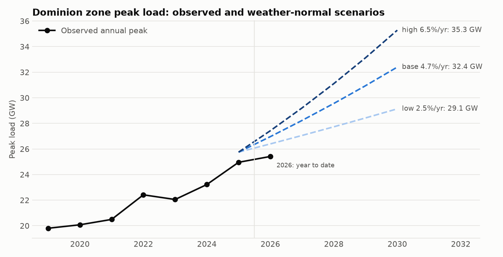
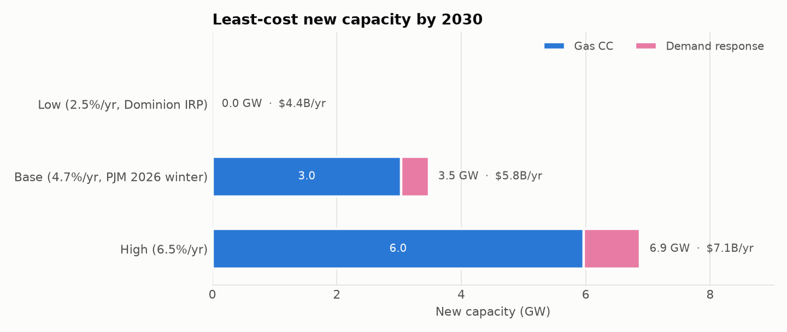
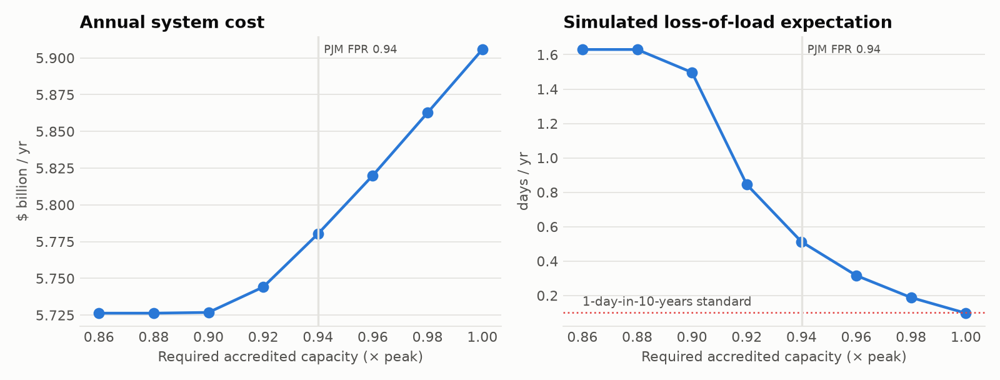

# ⚡ Grid Under Pressure

**How should Virginia's Dominion zone meet data-center load growth by 2030 — at least cost, without losing reliability?**

A forecasting → optimization → risk pipeline built on public data:
EIA-930 hourly demand for PJM's Dominion subregion, ERA5 weather, and PJM's capacity-market and load-forecast parameters.

[**▶ Live demo**](https://grid-under-pressure-ahmedomansour.streamlit.app) &nbsp;·&nbsp; [Decision memo](docs/decision_memo.md) &nbsp;·&nbsp; [Assumptions](config/assumptions.yaml)

> **Headline.** Under PJM's 2026 growth outlook (4.7%/yr), Dominion's weather-normal peak climbs from **25.8 GW (2025) to 32.4 GW by 2030**. Meeting PJM's planning requirement takes **3.5 GW of new capacity** (3.0 GW gas combined cycle + 0.4 GW demand response), for a total system cost of **$5.78B/yr**.
>
> **But that plan fails the reliability test.** Across 1,000 simulated years it loses load **0.51 days/yr, five times the 1-day-in-10-years standard**, because cold snaps knock out gas plants exactly when winter demand peaks. Closing the gap takes **2.1 GW more capacity (+$125M/yr, +2.2%)**, *or* winter-proofing the existing fleet. Without correlated cold-weather outages the same plan scores 0.09 days/yr and passes.



---

## Why this problem

Northern Virginia is the largest data-center market in the world, and the load is landing on one utility zone. In the EIA-930 data used here, Dominion's winter peak rose from 17.5 GW (2019–20) to **25.4 GW (2025–26), up 45%**, and average load rose 32% from 2019 to 2025. PJM's 2026 Load Forecast puts Dominion-zone peak growth at roughly 3.9%/yr (summer) and 4.7%/yr (winter) over the next decade, well above the 3.6%/yr PJM-wide. The zone already relies on imports: its emergency import limit (CETL) is 6,441 MW against a reliability requirement of ~27.5 GW of accredited capacity. Somebody has to decide what to build. This project models that decision.

## What the model does

```
EIA-930 hourly load ─┐
                     ├─► 1. Clean ─► 2. Load-shape model ─► 3. Scenarios ─► 4. Capacity LP ─► 5. Monte Carlo
ERA5 weather ────────┘     (gaps,      (gradient boosting,    (low/base/high   (PuLP + HiGHS,     (1,000 simulated
                           outliers,    weather-year           growth, flat     rep. days,         years: weather,
                           DST)         ensemble)              DC load)         FPR requirement)   outages, load error)
```

| Step | Method | Key file |
|---|---|---|
| Data | EIA API v2 (`region-sub-ba-data`, `subba=DOM`), Open-Meteo ERA5 archive, 2 weighted stations | `fetch_eia.py`, `fetch_weather.py` |
| Cleaning | Hourly UTC grid, robust spike detection (rolling median + MAD), only gaps ≤ 6 h interpolated | `clean.py` |
| Forecast | `load = level × shape(weather, calendar)`. Gradient-boosted trees learn the shape; the level is a scenario input, so the model never has to extrapolate a trend it can't. Backtested out-of-sample against a linear HDD/CDD benchmark | `forecast.py` |
| Scenarios | Weather-normal base peak × (1+g)^5; increment added as flat data-center load | `scenarios.py` |
| Optimization | Least-cost capacity-expansion **LP**: gas CC/CT, tracking solar, 4-h batteries, demand response, imports, an existing fleet in tranches; hourly dispatch on k-means representative days; PJM-style reliability requirement (ELCC-accredited capacity + imports up to CETL ≥ FPR × peak). Capital costs annualized with a capital recovery factor | `optimize.py`, `repdays.py` |
| Risk | Monte Carlo resource adequacy: random unit outages, correlated cold-weather outages (calibrated to Winter Storm Elliott), weather-year and load uncertainty → LOLE, LOLH, EUE vs. the 1-day-in-10-years standard | `reliability.py` |
| App | Streamlit: move growth, gas price, carbon price and the reliability requirement; LP + Monte Carlo re-solve live | `app/streamlit_app.py` |

## Results



| Growth scenario (2025→2030) | 2030 peak | New capacity | System cost | Simulated LOLE |
|---|---|---|---|---|
| Low, 2.5%/yr (Dominion IRP) | 29.1 GW | 0 GW | $4.43B/yr | 0.45 days/yr |
| **Base, 4.7%/yr (PJM 2026)** | **32.4 GW** | **3.5 GW** | **$5.78B/yr** | **0.51 days/yr** |
| High, 6.5%/yr | 35.3 GW | 6.9 GW | $7.06B/yr | 0.48 days/yr |

Every plan meets PJM's accredited-capacity requirement (0.94 × peak), and every plan misses the 0.1 days/yr standard in simulation.

**Is PJM's requirement enough for this zone?** Re-planning the base case at requirements from 0.86× to 1.00× peak and stress-testing each plan over 1,000 simulated years:



Reaching 0.1 days/yr takes about **1.00× peak** in accredited capacity: 5.6 GW of new build instead of 3.5 GW, for $125M/yr more.

**What the reliability conclusion depends on.** The same base-case plan, re-tested with one assumption changed at a time:

| Case | LOLE (days/yr) | Meets 0.1 standard? |
|---|---|---|
| Baseline assumptions | 0.51 | No |
| No correlated cold-weather outages | 0.09 | Yes |
| Cold-weather effect halved | 0.25 | No |
| Imports 100% deliverable during stress | 0.32 | No |
| Existing-fleet outage rate 4% (vs 6%) | 0.34 | No |

The finding rests mainly on the cold-weather assumption, calibrated to Winter Storm Elliott. That is the real policy question: build more capacity, or make existing gas plants perform in extreme cold.

**Why no solar or batteries?** Without tax credits, tracking solar in Virginia costs about **$85/MWh** (at a 20% capacity factor) against about **$31/MWh** to run existing gas at $3.50 gas, and PJM credits it with only 10% of nameplate at peak. Batteries cost about $346 per accredited kW-yr against $258 for a gas combined cycle. Neither enters the least-cost plan even at $8/MMBtu gas or a $100/t carbon price; they would need lower capital costs or tax credits, which you can test by editing `config/assumptions.yaml`.

**Forecast backtest** (out-of-sample, with each year's average load given):

| Test year | Gradient boosting MAPE | Linear HDD/CDD benchmark MAPE |
|---|---|---|
| 2024 | 3.2% | 6.4% |
| 2025 | 3.0% | 6.3% |

The tree model halves the error of the standard degree-day regression.

## Quickstart

```bash
git clone https://github.com/ahmedomhmansour/grid-under-pressure.git
cd grid-under-pressure
python -m venv .venv && source .venv/bin/activate      # Windows: .venv\Scripts\activate
pip install -r requirements.txt && pip install -e .
cp .env.example .env                                    # then paste your free EIA key into .env
python -m gup.run_all                                   # fetch → clean → model → figures (~5–10 min)
streamlit run app/streamlit_app.py
```

No key? `python -m gup.pipeline --demo` runs everything on synthetic data (outputs are stamped **DEMO DATA**). `pytest -q` runs the test suite.

## Assumptions that matter most

All inputs live in [`config/assumptions.yaml`](config/assumptions.yaml), each tagged `[SOURCED]`, `[DERIVED]`, `[ESTIMATE]` or `[JUDGMENT]` with its source. The answer is most sensitive to:

1. **Growth rate**: PJM (≈3.9–4.7%/yr) and Dominion's own IRP (2.5%/yr) disagree, which is why results are scenarios.
2. **Existing accredited capacity and imports**: 21,246 MW cleared in the DOM zone in PJM's 2028/29 auction, plus a 6,441 MW import limit (CETL).
3. **Accreditation (ELCC)**: PJM 2028/29 class ratings: gas CC 78%, CT 67%, 4-h storage 59%, tracking solar 10%, demand response 91%.
4. **Capital costs**: new gas plants now cost $2,000+/kW, roughly double older planning assumptions (GridLab 2025).
5. **Gas and carbon prices**: both are sliders in the app.

## Limitations

- **Single-zone, copper-plate model.** No transmission constraints inside Dominion and a fixed import limit from the rest of PJM.
- **LP, not MILP.** Capacity is continuous; real plants come in units. Unit commitment and ramping are ignored.
- **Flat data-center load.** Real campuses ramp in over years and have some flexibility; the flat block is a first-order assumption.
- **Solar output is a proxy** from horizontal irradiance, not a full PV simulation (pvlib would be the upgrade).
- **Reliability model** samples outages daily, treats the existing fleet as identical units, approximates correlated winter outages with a single temperature rule, and assumes a fixed share of the import limit is deliverable during stress.
- **Existing fleet split** between gas and coal/oil/other is an estimate; the total is PJM's cleared capacity.
- **Projections, not predictions.** Load forecasts in this region have been revised repeatedly.

## Data sources

- U.S. EIA, *Hourly Electric Grid Monitor* (EIA-930), API v2: <https://www.eia.gov/opendata/>
- Open-Meteo historical weather API (ERA5 reanalysis): <https://open-meteo.com/en/docs/historical-weather-api>
- PJM, *2026 Load Forecast Report* (DOM zone growth rates)
- PJM, *2028/2029 Base Residual Auction Report* and *ELCC Class Ratings for the 2028/2029 BRA*
- PJM, *2027/2028 BRA Planning Period Parameters* (DOM CETL)
- Dominion Energy Virginia, *2025 Integrated Resource Plan Update*
- U.S. EIA, *AEO2022 Cost and Performance Characteristics of New Generating Technologies* (Table 8.2); *Short-Term Energy Outlook*, Aug 2026
- GridLab, *The New Reality of Power Generation* (Sep 2025), gas plant capital costs
- EPA emission factor for natural gas (53.06 kg CO₂/MMBtu)

## Project structure

```
config/assumptions.yaml   every model input, with sources to verify
src/gup/                  pipeline package (fetch, clean, forecast, scenarios, optimize, reliability, figures)
app/streamlit_app.py      interactive planner
tests/                    pytest suite (runs offline on synthetic data)
outputs/                  results.json, figures, weather-year ensemble (committed so the app can deploy)
docs/decision_memo.md     one-page recommendation written for a non-technical reader
```

---
Built by Ahmed Mansour · B.S. Systems Engineering, University of Virginia · MIT License
